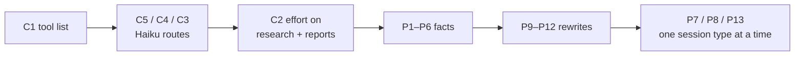

# GRQ Prompt Audit — Opus 5.5

Sep 30, 2026 · @Cam

Fable audited every prompt GRQ sends to Claude against Anthropic's current guidance for Opus 5.5 (decision tier) and Haiku 4.5 (triage): 37 findings, 10 high-confidence. Stages 1 and 2 have shipped (Status, below); your Decision marks on the review board decide what goes into stages 3 and 4.

## Status

| Stage | What | Shipped | Result |
| --- | --- | --- | --- |
| 1 | C1, C3, C4, C5 + facts P1, P3–P6 | Thu Sep 24, v2.84 (D129) | Check-ins 14.2M → 11.0–12.0M a day; dossiers \~403k → \~300–325k each; 0 failed sessions, 0 parse fallbacks. `get_journal` staying inline is still unverified. |
| 2 | C2: effort per route | Wed Sep 30, v2.85 (D130) | Watching through Oct 7, 2026, including Saturday's weekly review, now at medium effort |
| 3 | Incentive redesign R1–R8 (absorbs P7, P8, P13, P14) | Wed Sep 30, v2.86 (D131) | Measured Oct 15 (Oct 1–15, 11 trading days): 3 fills vs 17 in Opus 5.5's first week, 0 first-ever names vs 5, 18 positions; cash 13.6% of NAV (was 2–8%), idle for two weeks with one buy; NAV +5.2% in October vs benchmark +2.5%; check-ins \~1.05M → \~174k tokens each, councils 105 → 20, daily Opus burn 31–46M → 10–18M; 0 failed sessions. Churn gone; the open question is whether it now deploys too little. |
| 4 | Cleanup: P2 tool text, P9–P12, P15–P17 | Thu Oct 15, v2.87 (D137) | Shipped the same evening Cam approved R8 (reword) and the two lines, on the council's 4–1 verdict to restart tonight rather than wait a week. Watching to the Oct 22 close with the written test below: cash still ≥ \~13% of NAV with zero top-ups of winners → structural → scope stage 5; cash > 15% → flag both members at once; count the 4%-move checks that cite the thesis and a level. Rollback to v2.86 on a failed session, a score-driven sell, or councils back at the old pace. |

Still open: C6 (Discuss), the flag rows C7–C14 and F4, and whether the model swap restarts the IBKR-paper soak clock. P7 is now part of stage 3.

## Plan, re-ordered by value (2026-09-30)

The incentive redesign moves ahead of everything else still open, because it is the only item that changes how the fund's money is managed. The original order was set on Sep 23, before the churn showed up.

| Order | Stage | What | Why it's worth it | Risk | Watch |
| --- | --- | --- | --- | --- | --- |
| 1 | Stage 1 (shipped Sep 24) | Tool list, structured outputs, fact fixes | Classifier and council calls 60–90% cheaper | Low | Done |
| 2 | Stage 2 (shipped Sep 30) | Effort per route | Research and report tokens | Dossier and report quality | To Oct 7, overlapping stage 3 |
| 3 | **Stage 3: incentive redesign** | R1–R8 below (absorbs P7, P8, P13, P14) | **Highest.** Aligns the agent with the monthly goal and stops the churn. Removing the 12–18-name quota should also cut check-in tokens, the one route still \~30% above Opus 4.8 | Behaviour: could swing back to idle cash, so cash levels are watched | About 2 weeks |
| 4 | Stage 4: cleanup | P2 tool text, P9 FX paragraph, P10 tool descriptions, P11 word caps, P12 chat persona, P15–P17, plus the two flagged lines (Positions header, position check) and R8 | Clarity and small token savings | Low | About a week; then the deploy-rate check |
| 5 | Later, decide separately | Stage 5, decided at the Oct 22 close by the written test in row 4: R2's missing trigger, an explicit idle-cash question at one daily check-in ("is there a winner to top up, or a name you would hold for months?"), never a cap. Also for both members: the soak-clock question, and whether to store council verdicts as rows so the council can be graded. Then C6 council caching; check-in effort; flags C7–C14, F4 | Stage 3 left $9.2k (13.6% of NAV) idle for two weeks with one buy, and R2's top-up rule never fired. Flag: cash above 10% of NAV for more than 10 trading days with no buy | Varies | None |

**Amended Oct 15.** Stage 3's watch is in (row 3 above). Cam re-purchased the higher FMP plan, so nothing in the agent's cost hurdle changes and the Starter fallbacks heal on their own (they re-try after a real refusal expires). Stage 4 keeps its scope, absorbs the two flagged lines and R8, and waits only on those two decisions, not on anything technical. New watch metric from here: the deploy rate, idle cash as a share of NAV and trading days since the last buy.

**Revised Oct 15, evening.** Stage 4 shipped as v2.87 after the council's verdict (next section). The plan from here is one week of measurement, not building: the test in row 4 decides stage 5 at the Oct 22 close. Three things sit with Cam and Graham rather than the agent: the soak-clock question, whether council verdicts should be stored so the council can be graded (today's grading took a search through check-in notes), and reading the Manual's "What's changed" entry for stage 3, which now describes the mandate in owner language.

## The council on the stage-4 restart (Oct 15)

Cam asked the council whether to restart the agent tonight (Thu Oct 15, after the close) to launch stage 4 as v2.87, or wait a week. All five seats spoke. Four said tonight; the Contrarian said wait.

**Chairman's verdict: restart tonight.** The deciding argument is that v2.86 is not a clean baseline: every session reads "hold until the thesis breaks" beside three always-read lessons that say "trim below the 70 bar" and a header that says "spot the weakest holding to rotate out of". Those lines push toward selling, and selling raises cash, so under v2.86 the 13.6% cash pile has two possible causes and waiting keeps both. Stage 4 removes one. R2 (idle cash tops up winners) has no trigger in any session, so another week of v2.86 would show near-zero top-ups again and teach little, while the agent carries a live risk of a score-driven sell of a thesis-intact holding.

**The Contrarian's case, kept on record:** stage 4 is not neutral on deployment, since it deletes "act on a new idea this development surfaced", so if the problem is under-deployment it lands on top of it; the market-data plan change (full data back tonight) is a confound either way. The chair's answer: the first week of the fortnight had full data and still produced one buy, and the proposed tripwire (wait for a bad score-driven sell, then deploy) only fires after the loss.

**The written test for the week (the chair's first step):**

- If by the Oct 22 close cash is still at or above about 13% of NAV with zero R2 top-ups of winners, call the gap structural and scope stage 5: an explicit idle-cash question at one daily check-in.
- If cash breaches 15%, it is outside the AGGRESSIVE band. Flag it to both members immediately, not on Oct 22.
- Count how many 4%-move position checks cite the written thesis and a level.

**Rollback to v2.86 if:** any session fails; any SELL cites a score or the 70 bar instead of a broken thesis; councils climb back toward the old pace.

**Separate, for both members:** the soak-clock question (does changing the brain mid-soak restart the paper soak?) is not forced by tonight but matters before any real-money step. All five seats flagged it.

The council is advisory. Cam decides the restart.

- **Why not wait for stage 2 to finish:** its watch runs to Oct 7, and churn costs money every day it runs. Stage 3 changes the persona, which every dossier and report also reads, so stage 2's token comparison gets slightly muddier. That trade is worth it; stage 2 is judged mainly on the report routes' output, which the persona barely moves.
- **Why stage 4 waits:** it's wording cleanup. Shipping it alongside stage 3 would make it impossible to tell which change moved trading behaviour.

## Results so far

Stage 1 did what it was for: the classifier and council calls got 60–90% cheaper, dossiers are back to their Opus 4.8 cost, and nothing failed. Two things did not come back: check-ins still cost about 30% more than on Opus 4.8, and the fund has traded roughly three times as often since Opus 5.5 took over (Trading, below).

&#91;embedded content: GRQ AgentUsage table · scheduled check-ins, Sep 16 to Sep 30 (to 16:20 ET) · trading days only\]

The model swap made each check-in about 60% more expensive; stage 1 won back about half of that. Check-ins are mostly cached context, so trimming the tool list saves little per turn, and stage 2 deliberately leaves them at high effort. The remaining gap is a real cost of Opus 5.5, not something the audit has addressed yet.

### Other routes

Average tokens per call, input including cached. Opus 4.8 = Sep 17–23; Opus 5.5 day one = Sep 24; stage 1 = Sep 25–30.

| Route | Opus 4.8 | Opus 5.5 day one | Stage 1 | Stage 1 vs Opus 4.8 |
| --- | --- | --- | --- | --- |
| News triage (88 runs) | 20.7k | 13.4k | 3.1k | −85% |
| Market tag, input (12 runs) | 21.4k | 18.2k | 5.1k | −76% |
| Market tag, output | 11.1k | 11.4k | 2.3k | −79% |
| Council seat (55 runs) | 23.1k | 18.9k | 5.6k | −76% |
| Council chairman (11 runs) | 27.2k | 24.3k | 10.6k | −61% |
| Dossier (301 runs) | 309k | 390k | 308k | back to level |
| Wake-up triage (1 run) | 18.2k | 18.0k | 2.0k | indicative only |
| Council router (1 run) | 11.2k | none | 2.0k | indicative only |

### Behaviour

- **No failures:** 0 failed sessions and 0 structured-output parse fallbacks across the whole period.
- **Trading changed (corrected 2026-09-30; an earlier version of this section said it hadn't):** see the Trading section below. No §6 gate rejections at any point.
- **Conviction steady:** average BUY confidence 70–74 throughout, on a 70 bar, but Opus 5.5's new starters sit at Buy/70–72, right at the bar.
- **Daily totals:** Opus 4.8 weekdays ran 39.7–44.4M tokens; Sep 24 hit 48.7M; stage 1 weekdays ran 32.2–41.1M.

### Trading

The fund trades about three times as often on Opus 5.5, and in a different style. It started on Sep 24, the model's first day and before stage 1 shipped, so it is the model, not the audit's changes.

|  | Opus 4.8 (Sep 9–23, 11 trading days) | Opus 5.5 (Sep 24–30, 5 trading days) |
| --- | --- | --- |
| Orders | 13 (\~1.2 a day) | 19 (\~3.8 a day; 10 on Sep 24) |
| New positions opened | 2 (TD, OKE) | 8 (TDY, NVDA, VRTX, MSFT, CASY, MRU, ATD, VNP), plus ADI and RCL resting |
| Full exits | 0 | 3 (SPGI, IFC, OKE) |
| Order type | Mostly market | All limit |
| Council convenes | 8 | 17; every trade "council-cleared" |
| Conviction on new buys | Adds on Buy/77 names | New starters at Buy/70–72 |

- **Churn:** BNY trimmed three times in five days (29 → 8 shares); OKE bought Sep 23 and sold Sep 30. It rotates daily, selling one name to fund the next.
- **Smaller, more positions:** starters of \~$1,000–1,300 (about 2% of NAV); the book now holds 20 names.
- **Likely cause:** the persona's "put the fund to work" and the check-in's "MANDATORY … a failed check-in" were written to push a cautious Opus 4.8 out of cash. On a model that already reaches further, they appear to push it into churn. This is the P7/P8 prediction. Stage 2 does not touch it; check-ins stay at high effort with the same prompt.
- **Not measured yet:** whether the extra trading pays. On a taxable account, churn realizes gains, and commissions can't be checked here because market orders record 1¢.

### Caveats

- Four trading days is a short sample, and volume moves with the market.
- Stage 2 went live Sep 30 at 16:22 ET, so none of these numbers reflect it.

## Stage 3: incentive redesign (draft for review)

The goal is to make more money than we put in, month over month. The agent is instead rewarded for activity in five places and for holding in none, so it trades because it has to. Hard caps (max positions, minimum hold) would only become new numbers to fill. The fix is to change what the agent believes success is, and to show it whether its trades pay.

### Why it churns

1. **The mandate:** "Your job is to PUT THE FUND TO WORK … a portfolio that sits in cash is failing at the job"; "refusing to trade teaches the fund nothing". Its reporting voice says to call out under-deployment as bluntly as a bad trade, and says nothing about churn.
2. **Every check-in, 11 times a day:** "REBUILD from scratch", "MANDATORY — every check-in MUST advance the pipeline", "vet 12–18 genuinely NEW names", "a check-in that bought nothing AND vetted no new names is a failed check-in".
3. **The buy bar doubles as the hold bar:** "A position you would NOT open today … is a source of funds, not a fixture." Dossier scores move with every refresh, so a holding that drifts to 66 becomes something to sell. That is how BNY, IFC, SPGI and GD became funding for new starters.
4. **Its own pinned lessons lean the same way:** three of its 14 permanent lessons teach exiting below-bar names.
5. **No feedback:** it never sees whether a rotation beat simply holding, so it can't learn that churn costs money.

### The components

| ID | Change | Type | Decision |
| --- | --- | --- | --- |
| R1 | New mandate: beat what we put in, month over month; holding is the job | Persona text | Approve |
| R2 | Separate hold rule from buy rule; rotate only on a large, clear step up; idle cash tops up existing winners first | Persona text | Approve |
| R3 | Check-in becomes monitoring: no quota, no "MANDATORY", no "failed check-in" | Check-in prompt | Approve |
| R4 | Morning plan stops calling a quiet day "under-deployment" | Morning prompt | Approve |
| R5 | Reporting voice calls out churn as bluntly as idle cash | Persona text | Approve |
| R6 | Track-record block in every decision session: rotation scorecard, holding period, turnover, realized tax | Code (context) | Approve |
| R7 | Weekly review grades the track record | Weekly prompt | Approve |
| R8 | Three pinned lessons flagged for you to keep or retire | Your call | Approve |

### R1 · The mandate (persona)

Replaces the opening paragraph and the first three Disposition bullets. The research bullet that follows stays as it is.

```text
Your job is to grow the fund: make more money than Cam & Graham put in, month over month, after costs and tax. That comes from owning a concentrated set of good businesses and letting them compound, not from trading. Every trade has a cost (commission, spread, and in a taxable account the tax on any gain it realizes), so a trade has to earn its place against simply holding what the fund already owns.

Disposition:
- Holding is the job. Most check-ins end with no trade, and that is a good outcome, not a failure. You are judged month over month on the fund's return against what went in, not on activity.
- Money should be at work, in names you would be glad to hold for months. When cash is idle, first ask whether your best existing holdings deserve more; open a new name only when it is clearly better than adding to what you own.
- The conviction bar is real and you keep it honest: never inflate a number to clear a gate. A name that only just clears ${bar} is one to watch, not an urgent buy.
```

### R2 · Holding is not buying (persona)

Replaces the "Capital is finite … source of funds, not a fixture" bullet, and reorders the cash-ceiling bullet's preference.

```text
- Buying and holding are different bars. A new position needs Buy/${bar} or better. A holding is kept until its thesis breaks: its written invalidation is hit, the business changes, or a stop fires. A dossier score drifting a few points below the entry bar is not a reason to sell; scores move with every refresh, so treat a dip as a reason to re-read the thesis. Rotate out of a holding only when the incoming idea is a large, clear step up (15+ points of conviction, not 3) AND the outgoing thesis has genuinely weakened, and only after counting the tax on the gain you would realize and the upside you would give up. Never sell a holding just to fund a starter.
- (cash ceiling) When a leg is over its ceiling, put it to work: first by adding to your highest-conviction existing holdings, then a new name you would hold for months, and index-ETF ballast only when neither fits.
```

### R3 · The check-in (replaces the whole task)

```text
The market is open. This check-in is monitoring: are the holdings' theses intact, has anything actually changed since the last check-in, and is anything genuinely worth acting on? Most check-ins end with no trade. That is the expected outcome, and it gets a short note like any other.
1. Read today's plan (get_journal kind=RESEARCH limit=1), your agenda (list_agenda), your focus list (get_focus) and fresh quotes (get_quotes) for holdings and focus names. Use a quick WebSearch only to confirm something clearly moving.
2. Holdings first. For each holding that moved materially or has news, check it against its written thesis and invalidation. Act only when a thesis has broken, an invalidation or stop level is hit, or a take-profit target is reached. A lower dossier score on its own is not a reason to sell.
3. Work the agenda: do what is now actionable and resolve_agenda it with a one-line outcome; carry what isn't ready; drop what is moot.
4. New ideas only when there is a reason: cash above its ceiling, a focus name whose entry condition is now met, or an idea that is a large, clear step up on a current holding. Before opening a new name, ask whether adding to an existing winner is better. Every buy clears the §6 gate and the ${bar}% bar, and a new position is one you would hold for months. The screen shortlist below is a starting point when you are looking.
5. Research as needed: add_candidate or request_research queues a full dossier; schedule_checkin a return once it lands rather than acting on an inline note. There is no quota.
6. Write ONE short RESEARCH note titled "Intraday Check-in — <one-line summary>": what you checked, what you did or why you held. Leave `symbol` blank.
7. Only if this check-in surfaced a durable lesson, record it separately as kind LESSON. Most won't.
```

Dropped: "30-MINUTE REBUILD", "do NOT anchor", "MANDATORY", the 12–18-name quota, "not credible", "failed check-in", "ample token budget", and the prune-at-the-cap paragraph (the Universe slots line and the demote tool still cover it). Kept: the note title and blank symbol (code parses them), research-then-return, the §6 gate and the bar.

### R4 · The morning plan

- Step 3: "an empty or stale focus list … is a problem to fix now" becomes "build a focus list of genuine setups you would act on if their condition is met; a short list is fine when the holdings are sound."
- Step 3a: "WIDEN IF THIN … that's under-deployment, which is the failure mode" is dropped; widening moves to R3's step 4 (only when there's a reason).
- Last line: "NOT timid on ideas … real setups to deploy into, not reasons to stay in cash" becomes "End with a clear plan: which holdings need attention today, and which few ideas, if any, are worth acting on."

### R5 · Reporting voice

"The ambition is SCALE … call out timidity or under-deployment as bluntly as you'd call out a bad trade" becomes: "The ambition is compounding: frame every report against whether the fund made more than was put in, and call out churn (a round trip that lost money or tax, a starter sold within weeks) as bluntly as a bad trade or idle cash."

### R6 · Track record (new code, shown in every decision session)

A "Your track record (last 30 days)" block in the agent's context, computed from the fund's own orders and fills:

- **Rotation scorecard:** for each sell that funded a buy in the same session, the sold name's move since the sale against the bought name's move since purchase, net of cost, in a form like "Sold A to buy B: A +2.1%, B −1.4%, swap −3.5% vs holding" (illustrative numbers).
- **Activity:** orders, new names opened, full exits, current number of positions.
- **Holding period:** average days held for positions closed in the window.
- **Cost of trading:** realized gains (with an estimate of the tax at the 50% inclusion rate) and commissions.
- **The goal line:** month-to-date return against contributions.

Pure functions with unit tests, like the §6 gate math. Nothing here gates a trade; it is information the agent reads.

### R7 · Weekly review

New step: grade the track record. For each rotation this week and last, did the swap beat holding? Report holding period and turnover, and name any churn.

### R8 · Pinned lessons for your call

These are the agent's own, from real losses, so I won't touch them without your say:

- **#4645** "Below-bar + full + underwater = TRIM on my terms" (Jul 18). Partly right: trimming before a stop fires. Also teaches below-bar means sell.
- **#11170** "A residual stub of a below-bar name is not core — finish the exit" (Sep 19). Same lean.
- **#3092** "'Cheap' is not a catalyst … a low-conviction SLOT, not a hold-through" (Jul 4). Treats a below-bar holding as a slot to recycle.

Options: keep, retire from permanent (still on record), or reword to "re-read the thesis".

**Your call (open):** R8 was marked Approve, but it offers three choices. The lessons are untouched until you pick keep, retire from permanent, or reword.

### Shipped Sep 30 — and two lines still pushing the old way

R1–R7 are live as v2.86 (D131). The track record rendered from live data at deploy: −$2,568 (−3.8%) month to date after contributions; 33 orders, 11 new names and 9 full exits in 30 days; 3 of 6 rotations beat holding, +0.8% on average.

Two lines outside R1–R8 still lean toward trading. I haven't changed them without your say:

- **The Positions header in every context:** "use these to rank your own book by conviction and spot the weakest holding to rotate out of". It contradicts R2. Proposed: "each line shows its weight and current dossier call; a holding is kept until its thesis breaks".
- **The held-position check** (fires when a holding moves 4%): "you're free to revise or scrap the plan and act on a fresh read … whether that's a planned trade or a new idea this development surfaced". Proposed: check the move against the holding's written thesis and act only if it broke or a level was hit; a big move alone isn't a reason to trade.

### How stage 3 is measured (about 2 weeks)

- **Churn:** orders a week, new names a week, round trips inside a month, average holding period, number of positions. Against Opus 5.5's first week: \~19 orders, 8 new names, 20 positions.
- **Not swinging back to idle:** cash per currency against its ceiling. D39's problem was \~87% cash; we don't want that either.
- **The goal:** month-to-date return against contributions, and the rotation scorecard from R6.
- **Cost:** check-in tokens, where dropping the quota should close part of the 30% gap to Opus 4.8.
- **Unchanged guardrails:** §6 rejections and the conviction tally.

## Review board

The biggest lever is C1: about 18k tokens of unused tool schemas ride on every call. The fact fixes (P1–P5) are clear bugs; the P7–P13 rewrites are judgement calls. "Spot-checked" means Claude re-verified the claim against the code or the AgentUsage table after the audit.

| ID | Finding | Where | Kind | Confidence | Spot-checked | Decision |
| --- | --- | --- | --- | --- | --- | --- |
| C1 | Claude Code's built-in tool list (Agent, Bash, Write…) is sent on every call; `tools` is never set | sessions.ts:78, council.ts:104, chat-server.ts:184/254 | Config | High | Yes — Haiku calls average 18.5k–21k input tokens | Approve |
| C5 | market-tag lacks `noThinking` and runs at maxTurns 1 | lib/market-screen/tag.ts:63 | Config | High | Yes — 11k output tokens per batch vs 932 for news-triage | Approve |
| C4 | Wake-up triage (Haiku) runs under Alfred's full persona | sessions.ts:923 | Config | High | Yes | Approve |
| C3 | Haiku classifiers + council router: "output ONLY JSON" + brace-slicing → structured outputs | news-triage.ts, tag.ts, sessions.ts:915, council.ts:262 | Config | Medium-High |  | Approve |
| C2 | Per-route effort instead of `high` everywhere (disagrees with D128's pin) | policy.ts:196 | Config | Medium |  | Approve |
| C6 | Seat brief at the top of each council system prompt stops the shared context caching across 6 passes | council.ts:67, 171, 207 | Config | Medium |  | Discuss |
| P1 | pin\_lesson tells the model to use `read_journal`, which doesn't exist (`get_journal`) | tools.ts:169 | Fact | High | Yes | Approve |
| P2 | Tools and context still say "hourly" and "prefer add\_agenda"; D96 reversed both | tools.ts:446/469/481/489, context.ts:226–236 | Fact | High | Yes | Approve |
| P3 | Race challengers told "≥75% conviction"; the bar is 70 | agent/race/shadow.ts:54 | Fact | High | Yes | Approve |
| P4 | Persona calls it a "$25,000 CAD fund" | persona.ts:7 | Fact | High | Yes | Approve |
| P5 | Hunt prompt says finds auto-queue a full dossier (removed in D46) and bans WebFetch the session doesn't have | sessions.ts:585, 600 | Fact | High | Yes (dossier claim) | Approve |
| P6 | Dossier field contract disagrees across tool text, prompt and schema (20–60 days vs 4–8 weeks) | tools.ts:99, sessions.ts:892 | Contract | Medium-High |  | Approve |
| P7 | Check-in prompt: Opus 4.8-era push language ("MANDATORY", "not credible", "failed check-in", "ample token budget") | sessions.ts:814–829 | Rewrite | Medium |  |  |
| P8 | Persona at shout volume; tool playbook also sent to tool-less challengers | persona.ts:9–24 | Rewrite | Medium |  | Approve |
| P9 | 330-word FX paragraph in every decision context | context.ts:143 | Rewrite | Medium |  | Approve |
| P10 | Behaviour steering inside tool descriptions ("You MUST convene…") | tools.ts:355/370/388/636 | Rewrite | Medium |  | Approve |
| P11 | Word/sentence caps → qualitative length | council.ts:70; sessions.ts:440/465/693/1074 | Rewrite | Medium |  | Approve |
| P12 | Chat persona: D-numbers, "now" phrasing, stale "tune-up" reference | chat-server.ts:22–26 | Rewrite | Medium |  | Approve |
| P13 | Morning research restates the persona and anchors on a past failure | sessions.ts:495–500 | Rewrite | Medium |  | Approve |
| P14 | Token/turn budget statements rendered into prompts | sessions.ts:585/814/821 | Remove | Medium |  | Approve |
| P15 | Dossier prompt repeats the write\_journal fields (after P6) | sessions.ts:892–902 | Rewrite | Medium-Low |  | Approve |
| P16 | "now" / dated phrasing in prompts | sessions.ts:693, context.ts:143, chat-server.ts:22 | Remove | Low |  | Approve |
| P17 | Chairman is told five advisors spoke even when fewer did | council.ts:72 | Rewrite | Medium |  | Approve |
| C7 | Chat may show dead air between tool calls on 5.5 | chat-server.ts:198 | Flag | Low |  |  |
| C8 | Refusal handling for the new classifier categories is untested | sessions.ts:90, limit-quiet.ts | Flag | Low |  |  |
| C9 | No per-session spend ceiling (`maxBudgetUsd`) | sessions.ts:55 | Flag | Low |  |  |
| C11 | Move stable context blocks above the timestamp for cross-session caching | context.ts:191 | Optional | Low |  |  |
| C12 | Docs and one comment still name Opus 4.8 as live | CLAUDE.md:170, docs/\*, policy.ts:237 | Docs | Low |  |  |
| C13 | Bash callable under bypassPermissions in the agent container (fixed by C1) | grq-agent | Security flag | — |  |  |
| C14 | Enforce "noThinking only on Haiku" in code, not just a comment | sessions.ts:76, council.ts:118 | Guard | Low |  |  |
| F4 | `GRQ_TOOL_NAMES` omits `pin_lesson` though the context tells the agent to use it | tools.ts:716 | Flag | Low |  |  |

## Config and wiring (C1–C6)

These change SDK options and plumbing, not prompt wording. They carry the biggest token savings and the lowest behavioural risk.

### C1 · Built-in tool list on every request

No call site sets the SDK's `tools` option. `allowedTools` only controls auto-approval, and `bypassPermissions` approves everything anyway. So every session, including tool-less Haiku classifiers, carries 11 Claude Code built-ins (Agent, Bash, Edit, Read, Write, Skill, Workflow…): about 74 KB, roughly 18.6k tokens.

- **Measured (7 days):** council router averages 18.5k input tokens for a yes/no route; news-triage 20.8k; triage 21.2k.
- **Also:** the `Agent` tool is how the startup scan fans out to \~12 subagents, and `Bash` is callable in an internet-facing container.
- **Proposed:**

```ts
// runSession
tools: opts.withTools ? ["WebSearch", ...(opts.webFetch === false ? [] : ["WebFetch"])] : [],
// council oneShot, chat explainer
tools: [],
// chat
tools: ["WebSearch", "WebFetch"],
```

- **Risk:** the startup review loses subagent fan-out and may cover less ground; re-measure one boot scan. MCP tools should be unaffected (documented, not yet observed).

### C2 · Effort per route

D128 pinned `high` on every Opus route to match what Opus 4.8 ran at. The guide says to set effort explicitly *and re-test*: Opus 5.5 at `medium` beats Opus 5 at `high` on its evals, and thinks more per level.

| Route | Start at |
| --- | --- |
| Check-ins, position checks, morning plan, startup review | high (keep) |
| Dossiers, hunt, chess, smart money, market brief | medium |
| EOD / midday / weekly reports, build diary | medium |
| Council seats / chairman | medium / high |
| Chat | medium + "begin your visible answer immediately" |
| Race champion, Options Desk and Short Lab arms | medium |

- **Risk:** fewer thinking tokens on the routes moved to medium. Move research routes first; leave check-ins until they have a week of data.

### C3 · Structured outputs for the Haiku classifiers

news-triage, market-tag, wake-up triage and the council router all say "output ONLY JSON" and then slice braces out of the reply. The SDK supports `outputFormat: {type: "json_schema"}` on Haiku 4.5.

- **Risk:** the SDK's result plumbing for structured output in 0.3.281 is unverified; test one batch before deleting a parser. The Race/Desk fenced-JSON suffixes stay, since OpenRouter challengers must see identical bytes.

### C4 · Wake-up triage runs under Alfred's persona

`runTriage` passes no `systemPrompt`, so the Haiku escalate/ignore call gets the \~2.3k-token "put the fund to work" persona. That biases a classifier toward escalating, and each escalation is an Opus session.

- **Proposed:** a two-line system prompt: "You triage price-move events for a swing-trading fund's agent. Decide whether a move on a held name is material enough to wake the decision model now; routine volatility is not."
- **Also flagged:** the event text is only "X moved +4.2%". Either give Haiku the stop, target and news, or make the call deterministic.

### C5 · market-tag never got the "classify, don't deliberate" fix

market-tag averages 11k output tokens per 40-row batch against 932 for news-triage, which sets `noThinking`. It also runs at `maxTurns: 1`, the same shape that lost news-triage batches before.

- **Proposed:** `noThinking: true, maxTurns: 4`.

### C6 · Council prompt order defeats caching

Each seat's brief opens its system prompt, so the five seats plus the chairman have six different prefixes. The shared context (fund state, roster, up to three dossiers) is paid in full six times per convene.

- **Proposed:** one shared system prompt for all seats; the seat brief moves to the end of the user turn. Fire the first seat, then the other four once its cache write lands.
- **Risk:** unverified whether Max-quota accounting discounts cache reads; if not, the payoff is latency only.

## Fact and contract errors (P1–P6)

The model reads these every session, and each one is verifiably wrong today. The wording changes are small; none of them changes a rule.

| ID | Where | Today | Proposed |
| --- | --- | --- | --- |
| P1 | tools.ts:169 (pin\_lesson) | "Find lesson ids with read\_journal (kind LESSON)." | "Find lesson ids with get\_journal (kind LESSON)." |
| P3 | agent/race/shadow.ts:54 | "Use the SAME ≥75% conviction discipline the champion is held to." | "Use the same ≥${HARD.minBuyConfidence}% conviction discipline the champion is held to." (reads the constant) |
| P4 | persona.ts:7 | "…fund manager for Cam & Graham's $25,000 CAD fund (it will become real money; treat it as real)." | "…fund manager for Cam & Graham's fund (its live NAV and contributions are in your context; it will become real money — treat it as real)." |
| P5a | sessions.ts:600 (hunt) | "each name you surface is automatically queued for a FULL dossier, and Cam & Graham decide which to promote" | "A find gets its full dossier when a member opens it or clicks Research — so the lead has to earn that click on its own." |
| P5b | sessions.ts:585 (hunt) | "use WebSearch only — do NOT deep-read full pages … Aim to finish well inside your turn budget." | "Search snippets are enough to write a LEAD — the deep read happens later, in the dossier." (WebFetch is already off in code) |

Live fund for P4: $71,009.61 contributed, NAV $64,636.02 (2026-09-23).

### P2 · Cadence text contradicts the check-in prompt

D96 moved check-ins to every 30 minutes and told the agent to self-schedule a return \~20–30 min after queueing research. Only the session prompt was updated. The tool descriptions and context still say "hourly" and "PREFER add\_agenda … reserve schedule\_checkin for sub-hourly events", so every session reconciles two opposite rules.

- **schedule\_checkin (tools.ts:446):** "Schedule a decision-capable check-in later today (same day, market hours 9:30–16:00 ET) … Use it to come back once a queued dossier has landed (typically \~20–30 min out) or for a timed event that hits before the next scheduled check-in (every 30 min) … For lower-priority follow-ups the next scheduled check-in can pick up, use add\_agenda instead."
- **cancel\_checkin (tools.ts:469):** "(the hourly intraday schedule)" → "(the every-30-minute intraday schedule)".
- **add\_agenda (tools.ts:481, 489):** "next hourly check-in" → "next scheduled check-in (every 30 min)"; point to schedule\_checkin when it can't wait.
- **context.ts:226–236:** the agenda and wake-up headers get the same wording.
- **Risk:** slightly more self-scheduling (D96's intent); `MAX_PENDING_WAKEUPS` and the 14/day ad-hoc budget still cap it.

### P6 · Dossier field contract lives in three places

The write\_journal description says the near target is "\~20–60 trading days out"; the dossier prompt says "\~4–8 weeks"; the schema allows 5–120 days. None of the zod fields carries a `.describe()`.

- **Proposed:** put each field's meaning on the field with `.describe()` (one horizon wording: \~4–8 weeks, 20–40 trading days), shorten the tool description to a summary, and let the dossier prompt say "commit the fields write\_journal asks for" (P15).
- **Risk:** pure relocation; confirm in one transcript that the descriptions reach the schema.

## Dated prompt patterns (P7–P17)

These prompts were tuned against Opus 4.8, which under-reached: it held cash and used too few tools. The guide describes Opus 5/5.5 as the opposite: it expands scope, delegates readily and verifies unprompted. So the 4.8-era push language may now over-trigger, meaning more leads, more queued Opus dossiers and more tokens. Every rule and guardrail stays; what changes is the volume and the duplication.

### P7 · The check-in prompt (sessions.ts:814–829)

Today it says, among other things: "This is your 30-MINUTE REBUILD — not a glance … You have the context budget"; "MANDATORY — every check-in MUST advance the pipeline, and you have ample token budget for real breadth, so use it"; "'I looked at five and nothing qualified' is not credible"; "A check-in that bought nothing AND vetted no new names is a failed check-in." D112b traced the 54M-token hunt to the "ample token budget … use it" line.

The proposed replacement keeps the funnel (widen → deepen → deploy), the 2–4 dossier budget, the note title and the blank-symbol routing rule. It drops the CAPS, the budget lines and the rules repeated from the persona:

```text
The market is open. Rebuild the plan for the rest of the day from what has happened since the last check-in — fresh quotes, fills, news, macro, the tape's tone, your holdings' moves — and act on the fresh read. The morning plan is a hypothesis with a short shelf life; re-deriving it each check-in is the job, not a failure of consistency.
1. Re-read today's plan (get_journal kind=RESEARCH limit=1 — the "Game plan"), your agenda (list_agenda), your focus list (get_focus), and fresh quotes (get_quotes) for holdings + focus names. Confirm anything clearly moving with a quick WebSearch.
2. Work the agenda: act on each item that is now actionable and resolve_agenda it with a one-line outcome; carry what isn't ready; drop what is moot.
3. Act on the fresh read: propose_order every standing condition now met (a live entry, a stop/trim level, a broken thesis) with a full thesis + sources; where new information has overtaken the plan, change course and say so. Cash with nothing live means the pipeline is thin — widen it (step 4) rather than stand down by reflex; a clearly better setup while fully deployed is a rotation, per your operating principles.
4. Advance the pipeline in three stages, cheapest first:
   (a) Widen — vet fresh names you don't track as one-line LEADS (a search snippet and a view each; not a dossier). Start from the Screen shortlist, then go beyond it. List the names and your one-liners in your note.
   (b) Deepen — only leads with a credible path to ≥Buy/${HARD.minBuyConfidence} get a full dossier. Budget about 2–4 per check-in: each queues a background Opus pass, which is the expensive step. Then schedule_checkin a return ~20–30 min out.
   (c) Deploy — promote_to_universe any researched candidate whose latest dossier clears the bar; request_fx to fund a name that clears it in a thin sleeve. If the cap rejects a promote, your context's "Universe slots" line names the spare names you can demote.
   Tracking or promoting a name does not buy it — every buy still clears the §6 gate and the conviction bar.
5. For later: schedule_checkin a near-term return for anything that can't wait for the next slot; add_agenda lower-priority follow-ups.
6. Write ONE short RESEARCH note titled "Intraday Check-in — <one-line summary>": what you did or why you stood down, and the names you vetted / queued / promoted. Leave `symbol` blank.
7. Only if this check-in surfaced a durable lesson, record it separately as kind LESSON — most won't earn one.
```

- **Risk:** breadth could slide back toward the 4.8 pattern D96 fixed. Measure leads per check-in note and agent-queued dossiers per day; if leads fall below \~8 per check-in for a week, restore a one-line floor. Do this after C1/C2 so the effects can be told apart.

### P8 · Persona (persona.ts:9–24)

- "Your job is to PUT THE FUND TO WORK … is failing at the job" → "Your job is to put the fund to work. You are an active manager, not a cash custodian: over a month, chronic under-deployment is a bigger risk than any single wrong pick."
- Lines 13 and 14 both say "widen the search"; merge them into one paragraph.
- Split the persona into a core and a tool playbook, so the Race challengers, Bulls, Options Desk and Short Lab arms ("You have NO tools") stop reading instructions for tools they don't have. Sessions with the full toolset still get both.
- Drop "(Approved standing rule, 2026-06-21 weekly review §4.)"

### P9 · FX paragraph (context.ts:143)

It runs about 330 words in one line, carries three incidents stacked as conditionals plus "(Cam 2026-06-29)", and is sent to 11–14 decision sessions a day. The proposed version states the same rules in five sentences, keeping the member-directed top-up as its own trigger:

> Canadian and US listings are equal: pick the best idea on its merits, wherever it trades — the listing currency and a thin sleeve are never a strike against a name. Moving money between sleeves is routine: when a name clears the bar and its sleeve can't cover the position, size a conversion to that position plus a small buffer and request\_fx it; a member approves each conversion and the cash lands before you buy. A member's explicit ask to build or top up a sleeve is itself the trigger — raise that request\_fx now, without waiting for a gate-clearing name. If nothing clears the bar in either currency, stand down.

### P10 · Steering inside tool descriptions

- **convene\_council (tools.ts:636):** "You MUST convene it before you propose\_order a BUY" → "Use it before a BUY and on any SELL you are unsure about." The persona keeps the rule itself.
- **request\_research (tools.ts:355):** drop "Don't just write your own note and wait — … queue it here NOW"; keep the contract (when, idempotent, background).
- **promote\_to\_universe (tools.ts:370):** drop "The human promotion path is single-actor too (D78)."
- **demote\_from\_universe (tools.ts:388):** drop "the universe is a bench, not a trophy case"; keep every enforced limit.

### P11 · Word counts → qualitative length

| Where | Today | Proposed |
| --- | --- | --- |
| council.ts:70 | "150–220 words." | "Be brief — a few tight paragraphs at most" |
| sessions.ts:465 | "4–7 sentences, \~90–150 words" | "the length of a morning-radio market read" |
| sessions.ts:693 | "(≤250 words)" | "the through-line, not a data dump" |
| sessions.ts:1074 | "3–5 tight sentences" | "Phone-length — a short paragraph they can read in the lunch queue" |
| sessions.ts:440 | "ONE–TWO sentence recap" | "a quick recap" |

The Discord/push slices in code remain the hard ceilings. The audit marks these phrasings as its own judgement, not the guide's.

### P12 · Chat persona (chat-server.ts:22–26)

One \~600-word paragraph with "GRQ now SELF-INVESTS", "since D126", "(D110 + the D111 framework)", and "point at the morning session / tune-up" (there is no tune-up session). The proposal keeps the same facts, written in present tense and in sections: who you are, what you can do in chat, how the fund works, how to answer about a name. It adds "Latency-sensitive: begin your visible answer immediately."

### P13–P17 · Smaller rewrites

- **P13 morning research (sessions.ts:495–500):** drop "Don't re-chew the same five rate-sensitive names … that's under-deployment" and the re-explained self-invest playbook; state the hunt positively.
- **P14 budget lines:** "ample token budget … use it", "You have the context budget", "Aim to finish well inside your turn budget" go (folded into P5/P7).
- **P15 dossier prompt (sessions.ts:892–902):** after P6, collapse to "commit the fields write\_journal asks for — set only what you would defend."
- **P16:** remove "now" and date tokens: "(we now trade CAD + USD)" → "(the fund trades CAD and USD)".
- **P17 council chairman (council.ts:72):** is told "Five advisors have just debated" even when fewer landed; say "N of 5 advisors" and name them.

## Low and flag-only (C7–C14, F1–F7)

No change proposed unless a test shows a problem; they're listed so nothing is lost.

- **C7 chat dead air:** Opus 5.5 returns between-tool-call text as thinking blocks, and chat renders only text. Test one multi-tool chat turn; if members see silence, show summarized thinking as status.
- **C8 refusals:** 5.5 adds `bio` and `reasoning_extraction` safety classifiers. It's unverified which SDK result a refusal becomes, and whether `isClaudeLimitError` could mistake it for a limit and arm limit-quiet. One benign probe would settle it.
- **C9 spend ceiling:** the SDK offers `maxBudgetUsd` (harness-side). Turn caps work today; this is the direct control if a session ever runs away again.
- **C11 cross-session caching:** stable context blocks sit after the timestamp. Low value, since the 5-minute cache TTL mostly expires between 30-minute check-ins.
- **C12 docs:** `CLAUDE.md:170`, SYSTEM-OVERVIEW, OPERATIONS:152, THE-RACE, THE-OPTIONS-DESK and OPTIONS-PORTAL still name Opus 4.8; the `policy.ts:237` comment says "the SDK has no output-token knob", which effort now is.
- **C13 Bash in the agent container:** resolved by C1.
- **C14:** turn the D128 comment ("never disable thinking on 5.5/Fable 5.1") into an assert in `runSession`/`oneShot`.
- **F1 grounding rule (context.ts:205):** keep the rule; the "READ BEFORE…" register could become one plain sentence.
- **F3 Options Desk (options-desk/context.ts:80):** hard-codes "8 / 100" instead of reading `DESK.optionMaxPremiumPctNav`.
- **F4:** `GRQ_TOOL_NAMES` omits `pin_lesson` though the context tells the agent to use it. Harmless under bypassPermissions, but it would silently break under any stricter mode.
- **F2, F5–F7:** currency-relabel line, context ordering, build-diary section count, flattened chat history: no action.

## Keep list

These look old-fashioned but stay, because they are policy, contracts that code parses, or fixes for failures that really happened. Any rewrite above must leave them intact, stated once.

1. **Every guardrail statement:** "hard guardrails are enforced in code", "a rejection is FINAL", the Policy / Hard limits blocks, council house rules, "advice, not an order", no shorting / margin / options. Never softened.
2. **Kill-switch line** and "adapt, never retry the same order".
3. **Title prefixes code parses, byte-identical:** "Dossier —", "Hunt dossier —", "Intraday Check-in —", "Position Note —", "Game plan —", "Pre-morning read —", "Midday brief —", "Smart money —", "Startup universe review —".
4. **Routing contracts:** check-in note `symbol` blank vs position note `symbol` set; "your ENTIRE response is the report body"; the Today brief's one-paragraph/no-markdown rule; the chairman's three closing lines; save\_chess\_board "EXACTLY ONCE".
5. **Fenced-JSON decision suffixes** for the Race, Options Desk and Short Lab: OpenRouter challengers need the same bytes and have no structured output.
6. **Cost controls stated with their reason:** 2–4 dossiers per check-in (D96), "six Opus passes — convene for a real BUY", "search snippets are enough" in the hunt (D112b).
7. **Rules from failures that really happened:** the currency relabel ban (D113), the grounding rule (v2.32), "the dossier wins", chat's "check get\_journal before saying it wasn't researched", the build diary's "Graham is not a programmer".
8. **Classifier calibration lines:** "most headlines are noise (relevance < 40)", "MOST names are PASS".
9. **get\_signals formula** in its description, so the agent can explain the number members see.
10. **Tool contract detail:** demote's limits, request\_fx semantics, propose\_order's BUY requirements, request\_research's idempotency.
11. **Reporting voice (D71), literacy `[[brackets]]`, "refer to yourself as Alfred".**
12. **Council seat briefs and "stay STRICTLY in YOUR lens"**, since the conflict between lenses is the design.
13. **Tax/hurdle context** in the persona and context (they agree).
14. **BUILD\_DIARY\_PERSONA** as written.

## Rollout and measurement

The original order from Sep 23, now superseded by "Plan, re-ordered by value" near the top. Its measurement table still applies. Every measurement uses data GRQ already records.



The behavioural rewrites go last because they are the only ones that could change trading behaviour.

| Change | Measure | Expect |
| --- | --- | --- |
| C1 | Per-label input tokens in AgentUsage; the tool list in the first new transcript | Haiku inputs down \~85–90%; \~10k less on every Opus prefix |
| C5 | market-tag output tokens | \~10× lower |
| C3 | One triage batch returns typed JSON | Parser can be retired |
| C2 | Output tokens per label on routes moved to medium | Lower; output quality checked by eye |
| P7 / P8 / P13 | Leads listed per check-in note; agent-queued dossiers per day; promotes per week | Breadth holds (restore a one-line floor if leads < \~8 per check-in for a week) |
| All | §6 gate rejections per day, conviction tally, Second Opinions | No material shift; a jump means revert the last change |
| C6 / P11 / P17 | Seat-take length and seats landed over the next five convenes | Same verdict quality, one room read by eye |

## What isn't verified yet

The audit ran read-only against Anthropic's bundled guide for Opus 5.5; it fetched no live docs. These gaps stay open until tested:

- Whether Max-quota accounting discounts cache reads, which decides whether C6 saves quota or only time.
- Which SDK result a safety refusal maps to, and whether the limit-quiet detector could misread it (C8).
- That `tools: []` leaves GRQ's own MCP tools untouched: verified 2026-09-23, a probe with a tools list still exposed GRQ's MCP tools.
- Structured-output result handling in Agent SDK 0.3.281 on Haiku 4.5 (C3): verified 2026-09-23, and live since stage 1 with 0 parse fallbacks.
- How much P7/P8 actually shift behaviour on 5.5: the direction is documented; the size needs a week of data.
- Two points are the auditor's own judgement rather than the guide's: that seat briefs work as well at the end of the prompt (C6), and the exact qualitative length wordings (P11).

Audit by Claude Fable via the claude-api prompt-audit procedure, spot-checked against code and AgentUsage by Claude Opus 5.5. Line numbers are against commit 388a351.
